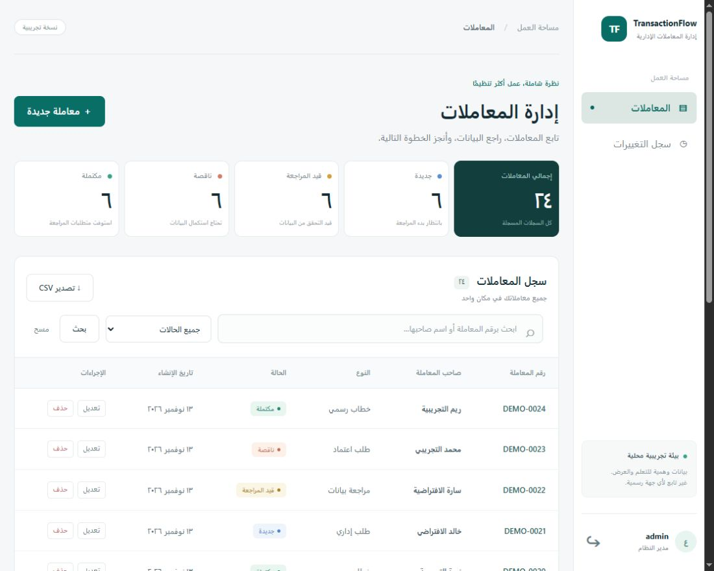

# TransactionFlow

نظام ويب عربي باتجاه RTL لإدارة المعاملات الإدارية ومراجعة البيانات، باستخدام HTML وCSS وJavaScript وPHP وMySQL/MariaDB وPDO.

مشروع مستقل لملف الأعمال لعبدالرحمن القرافي، مستوحى من إجراءات المراجعة الإدارية العامة. ليس تابعًا لأي جهة عمل سابقة. استخدم بيانات وهمية فقط.



## الوظائف المنفذة

- تسجيل الدخول وثلاث صلاحيات: admin وeditor وviewer.
- إضافة المعاملات وعرضها وتعديلها وحذفها بعد التأكيد.
- حالات جديدة وقيد المراجعة وناقصة ومكتملة.
- تحقق على الخادم والمتصفح ومنع تكرار رقم المعاملة.
- بحث بالرقم أو الاسم، وتصفية بالحالة، وترتيب الأحدث أولًا، وتقسيم الصفحات (15 سجلًا).
- إحصاءات لكل المعاملات، وتصدير النتائج المطابقة إلى CSV عربي.
- سجل تغييرات للمدير، ومنع تعارض التعديلات باستخدام version.
- واجهة متجاوبة ولوحة تفاصيل للقارئ.

## التشغيل عبر XAMPP / Apache

المتطلبات: PHP 8.2+ مع pdo_mysql وmbstring، وMySQL 8+ أو MariaDB 10.6+، ومتصفح حديث يدعم dialog وfetch.

1. انسخ مجلد المشروع إلى مكان عملك. افتح phpMyAdmin واستورد `database/schema.sql` بواسطة حساب إدارة محلي.
2. أنشئ حساب تطبيق مستقلًا. المثال التالي للتطوير المحلي؛ استبدل كلمة المرور قبل التنفيذ:

```sql
CREATE USER 'transactionflow'@'127.0.0.1' IDENTIFIED BY 'REPLACE_WITH_RANDOM_PASSWORD';
GRANT SELECT, INSERT, UPDATE, DELETE ON transactionflow.* TO 'transactionflow'@'127.0.0.1';
```

3. انسخ `config.example.php` إلى `config.local.php` وعدّل بيانات الاتصال. الملف المحلي مستبعد من Git.
4. أنشئ حسابًا محليًا. شغّل الأمر التالي من مجلد المشروع، ثم أدخل كلمة مرور من 12 محرفًا أو أكثر عبر الإدخال القياسي. الإدخال العادي في الطرفية قد يكون ظاهرًا، فلا تشارك شاشته:

```powershell
C:\xampp\php\php.exe scripts/create-user.php admin admin
```

لإنشاء محرر أو قارئ استخدم دور editor أو viewer بدل admin.

5. اختياريًا أضف 24 سجلًا وهميًا:

```powershell
C:\xampp\php\php.exe scripts/seed.php --demo
```

6. شغّل نسخة التطوير المحلية:

```powershell
.\Start-Local.ps1 -PhpPath C:\xampp\php\php.exe
```

افتح http://127.0.0.1:8090 وسجل الدخول بالحساب الذي أنشأته. أو اضبط Apache VirtualHost بحيث يشير DocumentRoot إلى مجلد `public` فقط. لا تجعل جذر الموقع مجلد المشروع الأب. قاعدة البيانات تبقى محفوظة بعد إغلاق المتصفح أو إعادة تشغيل التطبيق.

## بنية المشروع

```text
public/       الواجهة ونقطة API العامة فقط
app/          تهيئة الاتصال والجلسات وأدوات الخادم
database/     مخطط قاعدة البيانات
scripts/      إنشاء المستخدمين وإدخال البيانات الوهمية عبر CLI
tests/        اختبارات تكامل تعمل على قاعدة اختبار مستقلة
docs/         تقرير الاختبارات وملاحظات الأمان والتسليم
```

تتواصل الواجهة مع `public/api.php` باستخدام JSON. تستعمل GET للعرض والتصدير، وPOST للإضافة والدخول والخروج، وPUT للتعديل، وDELETE للحذف. API تتحقق من الجلسة والصلاحية وCSRF ثم المدخلات، وتستخدم معاملات SQL عند تعديل البيانات مع التدقيق. الإحصاءات تشمل جميع السجلات، بينما عدد النتائج والتصدير يتبعان البحث الحالي. تُقرأ تواريخ قاعدة البيانات بتوقيت UTC وتُعرض في الواجهة بتوقيت الرياض، ويبيّن عنوان عمود CSV أن الوقت UTC.

## التحقق والحدود

راجع `docs/TEST-REPORT.md` لنتائج الاختبارات الفعلية و`docs/SECURITY.md` لشروط النشر. لا تعتبر هذا الإصدار معتمدًا أمنيًا للاستخدام العام. النسخ الاحتياطي المجدول، وإدارة المستخدمين من الواجهة، واستعادة كلمات المرور، والمرفقات مزايا لاحقة.

نطاق التسليم هو كود قابل للتشغيل محليًا وموثق لملف الأعمال. لا يتطلب استضافة أو نشرًا عامًا. لم تُختبر استعادة النسخ الاحتياطية أو فتح التصدير في تطبيق Excel نفسه؛ لا ندعي اكتمال هذه الاختبارات.

## الاختبارات الآلية

تتضمن `.github/workflows/ci.yml` فحص الصياغة واختبارات التكامل على MariaDB 11.4 في بيئة مؤقتة. ملف سير العمل لا ينشر التطبيق. نجاحه على GitHub يُحدد من تبويب Actions، منفصلًا عن نتائج الاختبارات المحلية المسجلة في التقرير.

لإعادة الاختبار يدويًا، استخدم **نسخة منفصلة من المصدر** وقاعدة MariaDB مؤقتة على المنفذ 3317 بحساب root محلي دون كلمة مرور، لا تحتوي على بيانات مهمة. أداة التهيئة التالية تنشئ قاعدتي `transactionflow` و`transactionflow_test` وحساب تطبيق محدودًا، وتولد كلمات مرور عشوائية داخل ملفات مستبعدة من Git. لا تشغّلها على خادم عمل أو قاعدة موجودة.

```sh
php tests/prepare-local.php --prepare
TRANSACTIONFLOW_CONFIG="$PWD/var/test-config.php" php -S 127.0.0.1:8091 -t public
```

في طرفية ثانية داخل النسخة نفسها:

```sh
python3 tests/integration.py
```

في PowerShell، اضبط متغير البيئة قبل تشغيل خادم الاختبار:

```powershell
$env:TRANSACTIONFLOW_CONFIG = "$PWD\var\test-config.php"
php -S 127.0.0.1:8091 -t public
```

قبل تكرار الاختبار شغّل `php tests/reset-test.php --reset-test`. عند العودة للتطبيق العادي احذف متغير `TRANSACTIONFLOW_CONFIG` من بيئة الطرفية. يمكن تخصيص منفذ قاعدة البيانات المؤقتة بمتغير `TRANSACTIONFLOW_DB_PORT` عند التهيئة. بيانات الدخول والتقرير الناتج موجودان في `var/` ولا يُرفعان إلى GitHub.

تفاصيل الطلبات والاستجابات في [مرجع API](docs/API.md)، وحدود الأمان في [ملاحظات الأمان](docs/SECURITY.md).

